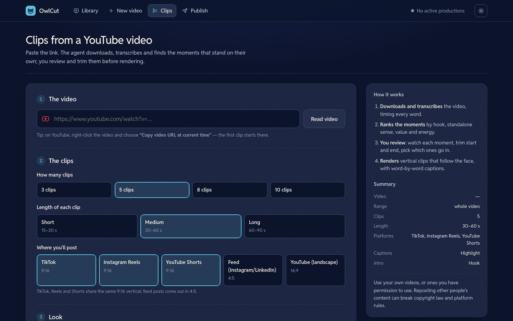
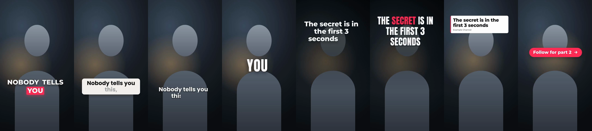

# OwlCut

**Turn a YouTube video into captioned vertical clips, review every cut yourself, and get a ready-to-post kit for each social network — all from a local web app driven by an AI agent.**

OwlCut is a fork of [OpenMontage](https://github.com/calesthio/OpenMontage), the agentic video-production system. It adds a browser studio on top of OpenMontage's pipelines:

| Page | What it does |
|---|---|
| **Clips** (`/clips`) | Paste a YouTube link. The agent downloads and transcribes it, ranks the moments that work on their own, and renders vertical clips that follow the speaker's face, with word-by-word captions. |
| **Review** (`/clips/<job>`) | Watch every suggested clip on a timeline of the source video, trim start and end in 0.5 s steps, choose which clips go in, and approve. Your decision goes straight back to the agent. |
| **Publish** (`/publish/<job>`) | Captions, titles and hashtags per network (TikTok, Reels, Shorts, feed), with each network's limits, copy buttons, "posted" tracking and a `.zip` organised by network. |
| **New video** (`/new`) | Make a video from a topic: research, script, narration, scenes and render, with approval at each stage. |
| **Library** (`/`) | Every project and production, with live status. |



## Caption and intro styles

Pick the look before the agent starts. Every preview is rendered by the same engine that builds your clips, so what you choose is exactly what you get.



Captions: **Highlight**, **Karaoke**, **Clean**, **Impact**. Intros: **Hook**, **Rising letters**, **Title card**. Ending: **Call to action**. Six accent colours, including the OwlCut cyan and amber. All layouts keep clear of the TikTok/Reels/Shorts buttons.

## Quick start

Requirements: macOS or Linux, Python 3.10+, Node.js 22+, a full FFmpeg build (with `libass`/`drawtext`), and the [Claude Code](https://claude.com/claude-code) CLI signed in to your account.

```bash
git clone <your-fork-url> OwlCut
cd OwlCut
make setup          # OpenMontage: Python deps, Remotion, Piper TTS, HyperFrames cache, .env
make setup-clips    # OwlCut: yt-dlp, YouTube transcripts, faster-whisper, face tracking
make owlcut         # starts the app on http://127.0.0.1:4750
```

Open <http://127.0.0.1:4750>, go to **Clips**, paste a link and click **Find the best clips**.

No API keys are needed for the clips workflow: downloading, transcription, face tracking and rendering all run locally. The agent runs on your Claude Code plan.

👉 **Full guide: [docs/USAGE.md](docs/USAGE.md)**: installation details, every screen step by step, the style kit, configuration and troubleshooting.

## How it works

```
/clips form ──► headless Claude Code session (clip-factory pipeline, AGENT_GUIDE.md rules)
                  │  downloads · transcribes · ranks · reframes · renders with the clip kit
                  ▼
        projects/<id>/clips/clips.json   ◄── the contract the agent keeps up to date
                  │
   /clips/<job> review ──► your selection and trims go back to the agent as a reply
                  │
   /publish/<job> kit  ──► your edits in clips/publish_edits.json · .zip per network
```

Following OpenMontage's design, Python only provides tools and persistence; the agent makes the creative decisions by following the pipeline's director skills. What OwlCut adds:

| Path | Purpose |
|---|---|
| `backlot/clipper.py` | YouTube link parsing and preview, the agent's brief, the `clips.json` contract, publishing kit and `.zip` export |
| `backlot/ui/` | The OwlCut web app (shared app bar, light/dark themes, Clips, Review and Publish pages) |
| `styles/clips/` | The clip kit: caption, intro and outro engine (HyperFrames + GSAP), style catalogue, rendered previews |
| `requirements-clips.txt` | Extra dependencies for the clips workflow |
| `tests/backlot/test_clips.py` | Tests for link parsing, the contract, publishing and the kit |

## Use it responsibly

Only clip videos you own or have permission to reuse. Reposting other people's content can break copyright law and platform rules. When the source isn't yours, the agent ends each caption with a credit line.

## Credits and licence

OwlCut is a modified version of **OpenMontage** by calesthio and contributors, licensed under the **GNU Affero General Public License v3.0**. This fork keeps the same licence; see [LICENSE](LICENSE) and [NOTICE.md](NOTICE.md) for what changed. The original README is kept at [docs/upstream/OPENMONTAGE_README.md](docs/upstream/OPENMONTAGE_README.md).

Caption and intro looks are adapted from items in the [HyperFrames](https://hyperframes.heygen.com) registry.
